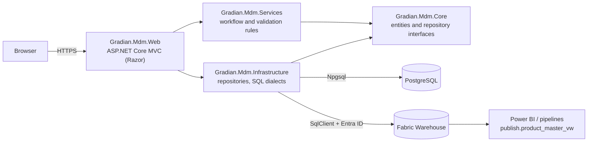

# Gradian MDM

Master data management for the **Gradian product master**. Business users browse the product hierarchy, propose changes, and have them approved by a second person before they reach the master record. Approved data is published to downstream systems (Power BI, pipelines) through a read-only view.

```
Product Family  →  Product Type  →  Model  →  Size  →  Product
(e.g. Air Cooling → AHU → Indoor → High Complexity → "Air Cooling – AHU – Indoor – High Complexity")
```

The app runs on either database engine, chosen by configuration:

| Engine | Driver | Typical use |
|---|---|---|
| **Microsoft Fabric Warehouse** | Microsoft.Data.SqlClient, Microsoft Entra ID sign-in | Production / client environment, next to the Fabric lakehouse and Power BI |
| **PostgreSQL** 13+ | Npgsql | Local development, CI, or Azure Database for PostgreSQL |

## Contents

- [Features](#features)
- [Architecture](#architecture)
- [Quick start (local, PostgreSQL)](#quick-start-local-postgresql)
- [Using Microsoft Fabric Warehouse](#using-microsoft-fabric-warehouse)
- [Configuration](#configuration)
- [Database scripts](#database-scripts)
- [Testing](#testing)
- [CI/CD and deployment](#cicd-and-deployment)
- [Security](#security)
- [Source data](#source-data)

## Features

- **Hierarchy browser**: the full product tree with product counts per node, filters by status and approval state, and text search over name, code, path, capacity group and SIOP model.
- **Product details**: every attribute with the field definitions from the source workbook, sibling products, and the full change history.
- **Maker / checker workflow**
  - A **Maker** edits a product; the change is stored as a *Pending Approval* request and the product keeps its current values.
  - A **Checker** reviews the request side by side with the current record and approves or rejects it (a rejection needs a comment). Nobody can decide their own request, and a product can have only one open request.
  - Checkers and Admins can also edit directly; the change is logged as *Updated Directly*.
- **Bulk update**: tick up to 200 products, edit them in one grid (with a *Set for all* row), and submit them with one reason. The batch is saved only when every row is valid.
- **Bulk approve / reject** from the approval queue or straight from the product list.
- **Column administration** (Admin): lock columns so nobody can change them, and give columns a display name that matches Gradian's naming. Only the on-screen label changes; database columns and the publish view keep their names.
- **User administration** (Admin): create accounts, set access levels, reset passwords, disable accounts.
- **Publish view** `publish.product_master_vw` with the workbook's original column headers, for downstream consumers.

### Access levels

| Level | Role | Can |
|---|---|---|
| 1 | Viewer | Browse products, details, history and the field dictionary |
| 2 | Maker | Viewer + submit single and bulk changes for approval |
| 3 | Checker | Maker + approve / reject requests, edit directly |
| 4 | Admin | Checker + manage users and column settings |

## Architecture



| Path | Contents |
|---|---|
| `src/Gradian.Mdm.Web` | Controllers, Razor views, security (role filter, headers), startup (`Program.cs`) |
| `src/Gradian.Mdm.Services` | Product master browse and maker / checker workflow, column locks and labels, user accounts, password hashing |
| `src/Gradian.Mdm.Infrastructure` | `DbSession` (one connection per request, transactions), SQL dialects for PostgreSQL and Fabric, repositories |
| `src/Gradian.Mdm.Core` | Entities and repository interfaces; no dependencies |
| `db/postgres`, `db/fabric` | Schema, seed data, demo users and permissions for each engine |
| `db/tools` | Generator for the seed scripts (from the source workbook) |
| `data` | Source workbook `Product_Master v2.0.xlsx` |
| `tests/Gradian.Mdm.Tests` | Unit tests (xUnit), no database needed |
| `tests/e2e` | End-to-end tests that drive the running app over HTTP |
| `.github/workflows` | CI, CD and CodeQL pipelines |

**How the two engines are supported.** Repositories write plain, parameterised SQL that runs on both engines and ask a small `ISqlDialect` only for what differs: boolean literals, how new keys are made, parameter types and error codes. Every write is one transaction that updates the product row first, which serialises concurrent writers on both engines. Fabric Warehouse has no identity columns and does not enforce unique constraints, so on Fabric the app takes new keys from `mdm.key_counter` and checks product-name uniqueness and the one-open-request rule itself, inside the same transaction. Transactions that Fabric aborts because of a concurrent write are retried automatically (up to 3 times).

**Tech stack:** .NET 10 (LTS), ASP.NET Core MVC, Serilog, Bootstrap 5 and Bootstrap Table (served locally, no CDN), xUnit, Python 3 (standard library only) for end-to-end tests.

## Quick start (local, PostgreSQL)

Prerequisites: [.NET 10 SDK](https://dotnet.microsoft.com/download), PostgreSQL 13 or later (`psql` on the `PATH`), Python 3.10+ for the end-to-end tests.

1. **Create and load the database**

   ```bash
   createdb gradian_mdm
   psql -d gradian_mdm -v ON_ERROR_STOP=1 -f db/postgres/001_schema.sql
   psql -d gradian_mdm -v ON_ERROR_STOP=1 -f db/postgres/002_product_master_seed.sql
   psql -d gradian_mdm -v ON_ERROR_STOP=1 -f db/postgres/003_demo_users.sql      # demo / test only
   ```

2. **Store the connection string as a user secret** (kept outside the repository):

   ```bash
   cd src/Gradian.Mdm.Web
   dotnet user-secrets set "ConnectionStrings:Mdm" "Host=localhost;Port=5432;Database=gradian_mdm;Username=postgres;Password=<your password>"
   ```

3. **Run the app**

   ```bash
   dotnet run --launch-profile http
   ```

4. Open <http://localhost:5081> and sign in with one of the demo accounts. In Development the sign-in page lists them; click a row to fill in the user name.

   | User name | Role | Password |
   |---|---|---|
   | `viewer1` | Viewer | `Demo@123` |
   | `maker1`, `maker2` | Maker | `Demo@123` |
   | `checker1` | Checker | `Demo@123` |
   | `admin1` | Admin | `Demo@123` |

## Using Microsoft Fabric Warehouse

1. **Create a warehouse** in your Fabric workspace (for example `GradianMDM`). From its settings copy the **SQL connection string** (server name ending in `.datawarehouse.fabric.microsoft.com`).

2. **Create the objects and load the data.** Open the warehouse's SQL query editor (or SSMS, VS Code mssql, or `sqlcmd`) and run, in order:

   | Script | Purpose |
   |---|---|
   | `db/fabric/001_schema.sql` | Schemas `mdm` and `publish`, tables, key counter, views. Re-runnable. |
   | `db/fabric/002_product_master_seed.sql` | Product data (replaces all product data, including change requests). |
   | `db/fabric/003_demo_users.sql` | Demo accounts. **Demo / test environments only.** |
   | `db/fabric/004_app_permissions.sql` | Template GRANTs for the app's identity (edit the name first). |

   Each script is a single batch (no `GO`), so it runs as-is in the Fabric editor.

3. **Point the app at the warehouse.** Set the provider and a connection string that signs in with Microsoft Entra ID; there are no SQL passwords in Fabric:

   ```bash
   cd src/Gradian.Mdm.Web
   dotnet user-secrets set "Database:Provider" "FabricWarehouse"
   dotnet user-secrets set "ConnectionStrings:Mdm" "Server=<endpoint>.datawarehouse.fabric.microsoft.com;Database=GradianMDM;Authentication=Active Directory Default;Encrypt=True;Connect Timeout=60"
   ```

   | Where the app runs | `Authentication=` | Notes |
   |---|---|---|
   | Your machine | `Active Directory Default` | Uses your `az login` / Visual Studio sign-in. Your account needs access to the warehouse. |
   | Azure App Service | `Active Directory Managed Identity` | Turn on the App Service's managed identity and give it access to the warehouse (step 4). For a user-assigned identity add `User Id=<client id>`. |
   | Elsewhere | `Active Directory Service Principal` | Add `User Id=<app id>;Password=<secret>` and keep the whole string in Key Vault, never in a file. |

4. **Give the app's identity access.** Share the warehouse with the identity with **Read** permission only (no workspace role), then grant data access in the warehouse:

   ```sql
   GRANT SELECT, INSERT, UPDATE ON SCHEMA::mdm TO [<app-service-name>];
   GRANT SELECT ON SCHEMA::publish TO [<app-service-name>];
   ```

**How Fabric differs** (all handled by the scripts and the app): no identity columns, no DEFAULT / CHECK / FOREIGN KEY constraints, primary keys are informational (`NOT ENFORCED`), `varchar` uses a case-sensitive UTF-8 collation, `datetime2(6)` instead of `timestamptz`, and no recursive queries (the hierarchy view uses fixed joins; the tree is four levels deep).

> **Test status:** the Fabric dialect passes the full end-to-end suite against SQL Server 2019 using Fabric's default collation (`Latin1_General_100_BIN2_UTF8`), with only the `NOT ENFORCED` key statements left out because SQL Server doesn't accept them. Run the suite once against your Fabric warehouse before relying on it (see [Testing](#testing)).

## Configuration

Settings come from `appsettings.json`, then `appsettings.{Environment}.json`, user-secrets (Development only), environment variables (`Section__Key`) and command-line arguments, each overriding the previous. **No secrets belong in the `appsettings` files.**

| Setting | Default | Description |
|---|---|---|
| `ConnectionStrings:Mdm` | *(required)* | Database connection string. In App Service, add a connection string named `Mdm` (or a Key Vault reference). The app fails to start without it. |
| `Database:Provider` | `PostgreSql` | `PostgreSql` or `FabricWarehouse` |
| `Database:CommandTimeoutSeconds` | `30` | Timeout for each SQL command |
| `Security:LoginAttemptsPerMinute` | `10` | Sign-in attempts allowed per client address per minute |
| `Demo:ShowDemoAccounts` | `false` (`true` in Development) | Lists active accounts on the sign-in page. Keep `false` where outsiders can reach the app. |
| `Demo:Password` | *(empty)* | Optional password hint shown next to the demo accounts |
| `Serilog` | Console | Log levels and sinks ([Serilog settings](https://github.com/serilog/serilog-settings-configuration)) |
| `ASPNETCORE_FORWARDEDHEADERS_ENABLED` | – | Set to `true` behind App Service or another reverse proxy, so HTTPS and client addresses are seen correctly |

All timestamps are stored in UTC.

## Database scripts

| PostgreSQL | Fabric Warehouse | Contents |
|---|---|---|
| `001_schema.sql` | `001_schema.sql` | Schemas, tables, indexes / informational keys, `mdm.vw_product_master`, `publish.product_master_vw`. Idempotent. |
| `002_product_master_seed.sql` | `002_product_master_seed.sql` | 269 products, 417 hierarchy nodes, 22 field definitions. Generated; identical ids on both engines. |
| `003_demo_users.sql` | `003_demo_users.sql` | Five demo accounts (password `Demo@123`). Not for production. |
| `004_app_role.sql` | `004_app_permissions.sql` | Least-privilege access for the app (SELECT / INSERT / UPDATE only). |

| Table / view | Holds |
|---|---|
| `mdm.product_hierarchy_level` | The four level names |
| `mdm.product_hierarchy` | One row per hierarchy node, linked to its parent |
| `mdm.product_master` | One row per product, linked to its deepest hierarchy node, with its approval state |
| `mdm.product_master_audit` | Every change request and direct edit (maker, checker, values, remarks, timestamps) |
| `mdm.product_master_field` | The workbook's field dictionary |
| `mdm.column_edit_setting` | Admin column locks and display names |
| `mdm.user_account` | Sign-in accounts and access levels |
| `mdm.key_counter` | Fabric only: next key per table |
| `mdm.vw_product_master` | Each product with its full hierarchy path |
| `publish.product_master_vw` | Active products under the workbook's column names, for downstream use |

**Regenerating the seed data** after the workbook changes:

```bash
pip install openpyxl
python db/tools/generate_product_master_seed.py          # rewrites both 002_product_master_seed.sql files
```

Then re-run `002_product_master_seed.sql` on the database. This replaces all product data and change history.

## Testing

**Unit tests** (no database):

```bash
dotnet test
```

**End-to-end tests** start the app, drive it over HTTP as each demo user, and check the results: the maker / checker workflow, bulk update and bulk approval, column locks and display names, concurrent submissions, and the security controls (access levels, antiforgery, open redirects, password policy, rate limiting, security headers).

```bash
# PostgreSQL: --reset reloads the database named by the PG* variables and WIPES its data
export PGHOST=localhost PGUSER=postgres PGPASSWORD=<password> PGDATABASE=gradian_mdm_test
export ConnectionStrings__Mdm="Host=localhost;Database=gradian_mdm_test;Username=postgres;Password=<password>"
dotnet build src/Gradian.Mdm.Web
python tests/e2e/run_all.py --reset --start
```

To test against Fabric, load a separate test warehouse with the three `db/fabric` scripts, set `Database__Provider=FabricWarehouse` and the warehouse connection string, and run `python tests/e2e/run_all.py --start` (without `--reset`). The suites change product data, so reload `002_product_master_seed.sql` before running them again.

## CI/CD and deployment

| Workflow | Runs on | What it does |
|---|---|---|
| `ci.yml` | Pull requests, pushes to `main` | Restore (fails on vulnerable packages), build with warnings as errors, unit tests, then the full end-to-end suite against a PostgreSQL 17 service container |
| `cd.yml` | Pushes to `main`, manual | Publish once, deploy to **staging**, check `/health`, then deploy the same package to **production** |
| `codeql.yml` | Pull requests, `main`, weekly | CodeQL security analysis of the C# code |
| `dependabot.yml` | Weekly | Update pull requests for NuGet packages and GitHub Actions |

### One-time Azure setup for CD

1. **App Service** (Linux, runtime **.NET 10**) for each environment, for example `gradian-mdm-staging` and `gradian-mdm-prod`. Set *HTTPS only* on, minimum TLS 1.2, FTP off, health check path `/health`.
2. **App settings** for each App Service:

   | Name | Value |
   |---|---|
   | `Database__Provider` | `FabricWarehouse` (or `PostgreSql`) |
   | Connection string `Mdm` | The connection string, or a Key Vault reference `@Microsoft.KeyVault(SecretUri=...)` |
   | `ASPNETCORE_FORWARDEDHEADERS_ENABLED` | `true` |

   For Fabric, turn on the App Service's **system-assigned managed identity** and give it warehouse access ([step 4 above](#using-microsoft-fabric-warehouse)).
3. **Deployment identity**: create a Microsoft Entra app registration, add a **federated credential** for GitHub Actions (organization `mokumar-ITC`, repository `gradian-mdm-demo`, entity *Environment*, one credential each for `staging` and `production`), and give it the **Website Contributor** role on the two App Services only.
4. **GitHub**: create the environments `staging` and `production` (Settings > Environments). In each, add the secrets `AZURE_CLIENT_ID`, `AZURE_TENANT_ID`, `AZURE_SUBSCRIPTION_ID` and the variable `AZURE_WEBAPP_NAME`. Add **required reviewers** to `production`.
5. Set the repository variable **`DEPLOY_ENABLED`** to `true`. Until then CD only builds; it doesn't try to deploy.

Database scripts are not run by the pipeline: apply schema changes to each environment deliberately, before deploying code that needs them.

## Security

See [SECURITY.md](SECURITY.md) for the controls built into the app, how to report a vulnerability, and how to run the demo safely. In short: Entra ID / managed identity for Fabric, no secrets in the repository, hashed passwords, rate-limited sign-in, antiforgery on every POST, server-side access checks on every action, a strict Content-Security-Policy, least-privilege database access, and dependency and code scanning in CI.

## Source data

The product data comes from `data/Product_Master v2.0.xlsx` (sheets *Product Master* and *Product Master Fields*):

- `Product_Code` repeats in the workbook, so `product_id` is the key and `Product_Name` is the unique business key (unique ignoring case).
- When Model and/or Size are blank, the product hangs off the deepest level it has.
- RDHx under Air Cooling has a Size but no Model, so its Model is shown as "(Not specified)".
- Leading and trailing spaces, including non-breaking spaces, are trimmed from hierarchy names.

The workbook and the generated seed scripts contain Gradian business data, published here with Gradian's approval. Copy or reuse them elsewhere only with Gradian's approval.
